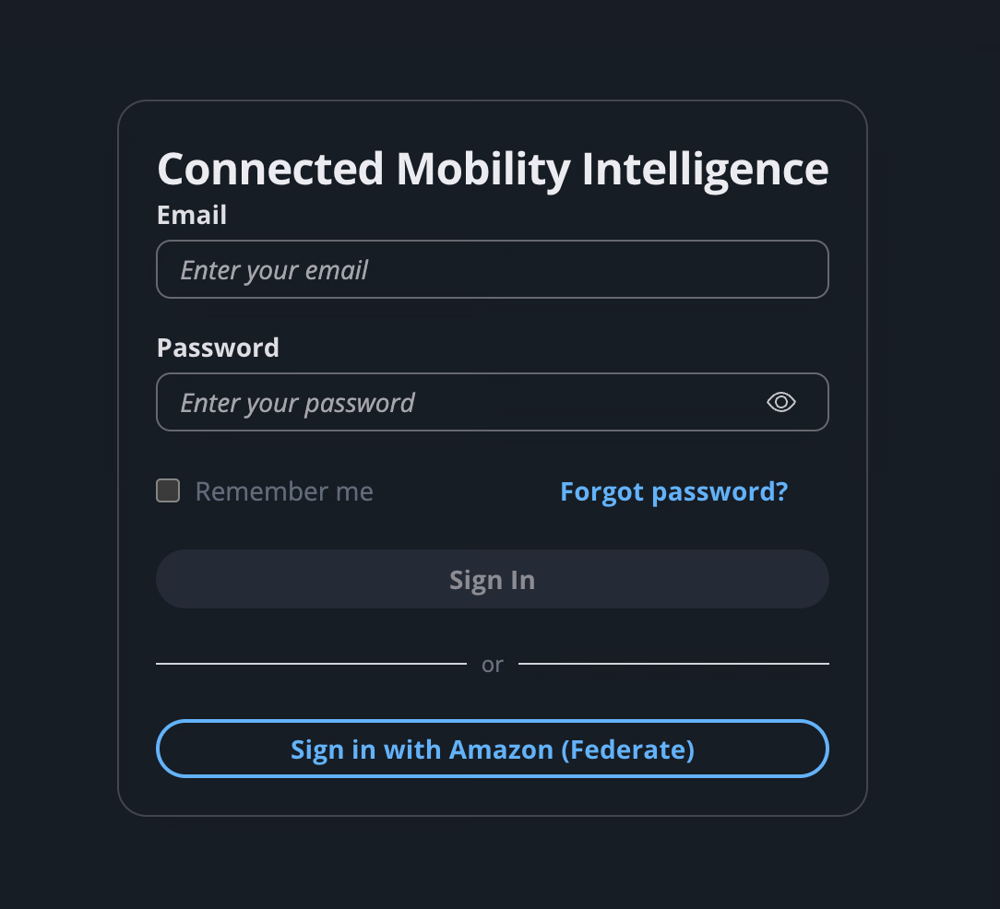
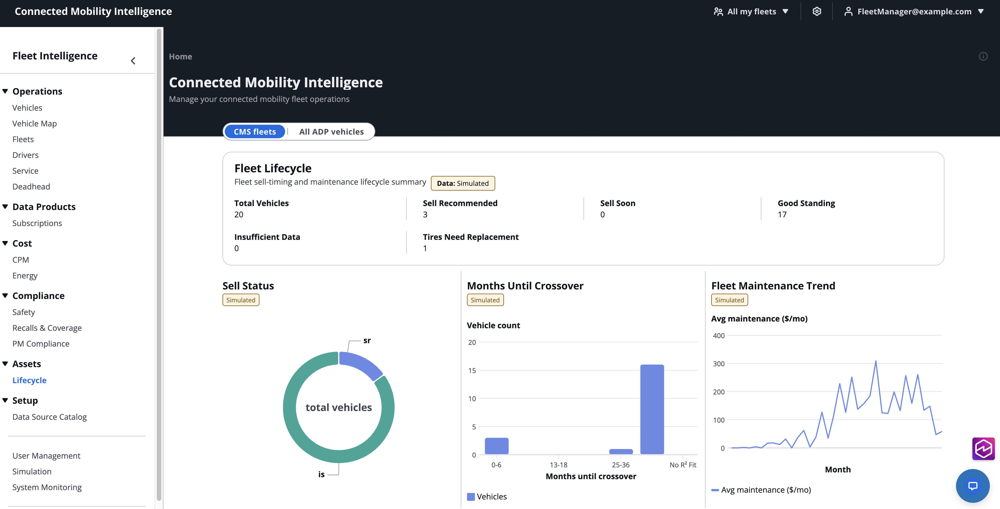
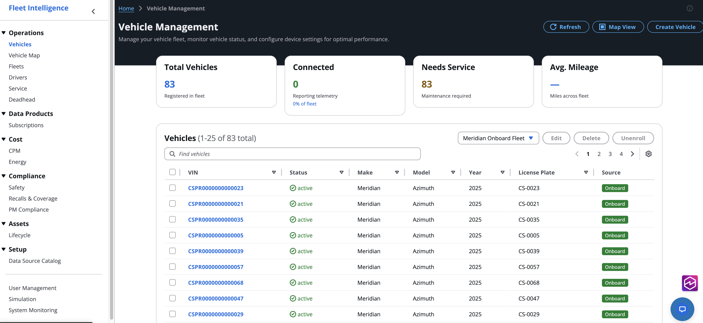
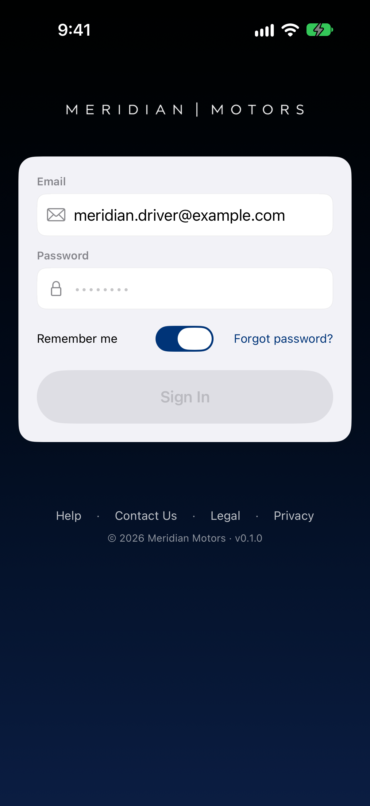
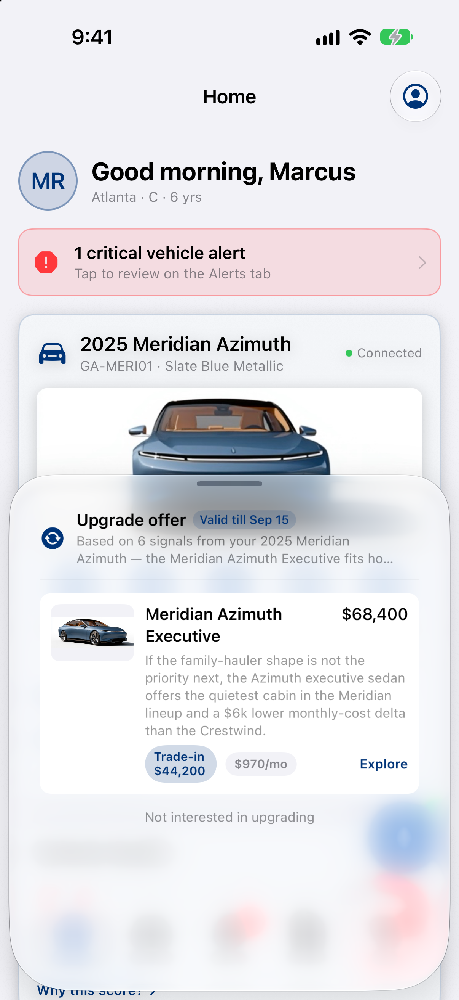
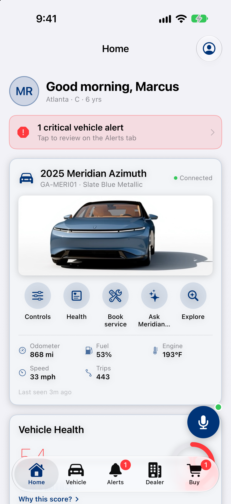
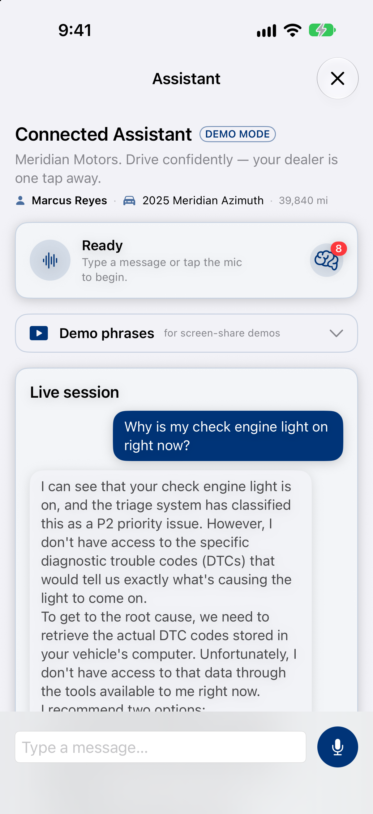

//!!NODE_ROOT <section>
[.topic]
[[ca-screens,ca-screens.title]]
= Consumer Acquisition Screens

This section shows the user interface for the Consumer Acquisition (Discover / Acquire) stages of the connected vehicle customer journey, across both web and mobile platforms.

== Web UI Screens

The web interface provides fleet operators and administrators with a centralized platform for managing connected vehicle operations.

=== Sign-In

Drivers and administrators access the fleet management platform through a Cognito-powered sign-in flow, supporting both direct authentication and federated sign-in via Amazon Federate.

=== Fleet Dashboard

The main dashboard provides an at-a-glance view of fleet status, including vehicle lifecycle metrics, fleet health summaries, and key performance indicators (KPIs).

The Fleet Lifecycle card surfaces sell-timing recommendations, maintenance requirements, and vehicle status distribution across the fleet.

=== Vehicle Management

The Vehicle Management screen lists all vehicles in the fleet with status, telemetry connectivity, maintenance needs, and metadata such as VIN, make, model, and year.

Operators can filter, sort, and drill into individual vehicle records to review detailed status and historical data.

== Mobile iOS App Screens

The iOS companion app delivers the connected vehicle experience to drivers on their personal devices, featuring real-time vehicle status, agentic conversation, and remote capability access.

=== Sign-In

Drivers sign in to their connected vehicle account via the iOS app, with support for both direct email/password authentication and Cognito federated sign-in.

=== Main Dashboard

After sign-in, drivers see the main dashboard featuring their assigned vehicle, key alerts, status indicators, and quick-access cards for common actions such as remote climate control and vehicle information.

The dashboard may display upgrade offers or promotional content contextually as part of the onboarding experience.

=== Vehicle Detail

The vehicle detail screen provides comprehensive information about the connected vehicle, including real-time telemetry, status history, maintenance schedules, and capability controls.

Drivers can review vehicle health, access remote operations, and navigate to service or other actions directly from this screen.

=== Agentic Assistant

The iOS assistant chat interface allows drivers to have natural-language conversations with the vehicle's agentic assistant (Meridian), powered by Amazon Bedrock's Nova Sonic voice model and AgentCore Runtime.

Drivers can ask vehicle-related questions, get recommendations, request services, and interact with the vehicle's capabilities through conversational speech or text input.

== Web Chat Assistant

The web UI also offers an agentic chat assistant, allowing drivers and operators to interact with the connected vehicle platform through natural-language conversation.

This provides a consistent conversational experience across both web and mobile channels, powered by the same Amazon Bedrock and AgentCore Runtime infrastructure.
